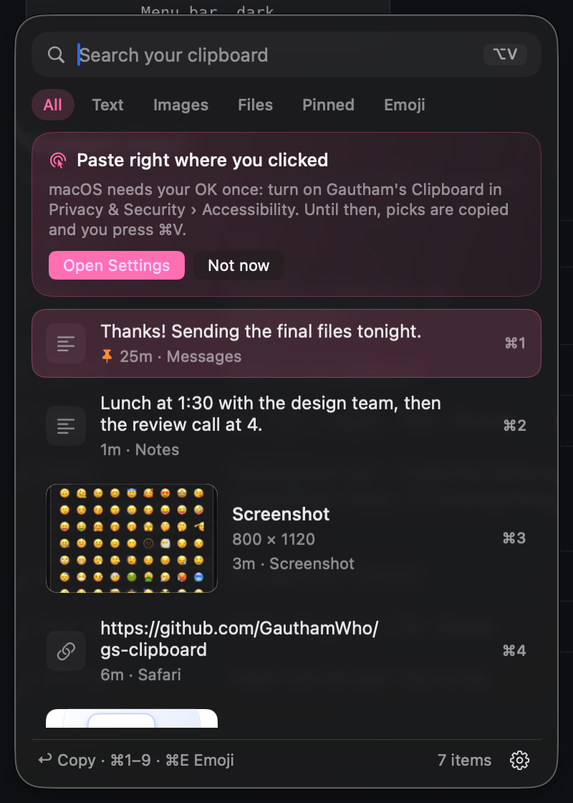
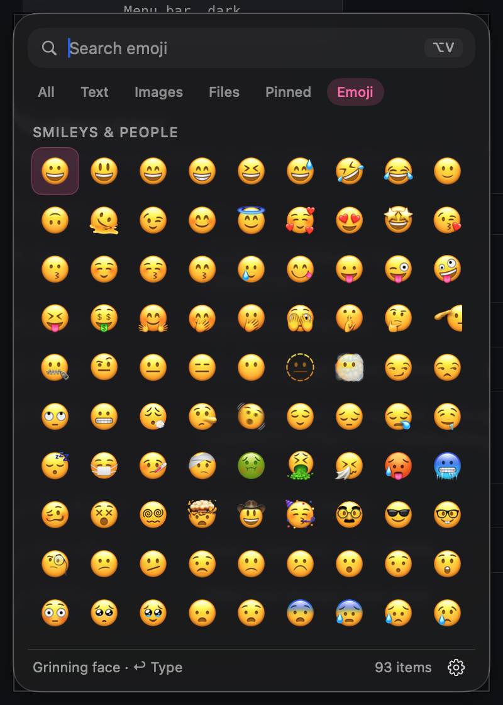

<p align="center">
  
</p>

<h1 align="center">Gautham's Clipboard</h1>

<p align="center"><b>Copy once, find it forever.</b> A free, private clipboard manager for macOS by GauthamWho.</p>

<p align="center">
  
  
  
  
</p>

**Gautham's Clipboard** remembers everything you copy: text, links, screenshots,
photos and files. Click into any text field, press **⌥V**, pick an item, and it is
**pasted right where your cursor is**. It also has every emoji, one shortcut away.

No subscription. No account. No ads. Nothing leaves your Mac.

<p align="center">
  
  &nbsp;&nbsp;
  
</p>

---

## What's new in 2.0

- **Pastes where you clicked.** Pick an item and it is typed into the field you
  were in, like every Mac clipboard manager. (Needs Accessibility once; see below.)
- **Opens next to your cursor, never on top of it.** The panel appears just under
  the line you're typing in (above it when there's no room), so you can still
  see your work. From the menu bar icon it drops down under the icon.
- **Real image previews.** Screenshots get a large thumbnail in the list, and
  hovering one opens a big preview beside the panel.
- **Emoji tab (⌘E).** All of Apple's emoji (including 👨‍💻 and flags) in keyboard
  order, searchable by name, with your recent ones first. Emoji are typed
  straight in and leave your clipboard alone.
- **Smart storage.** Old, unused items clean themselves up; anything you reuse
  stays. Password-manager copies are never saved. Details below.
- **New look.** Native Liquid Glass on macOS 26 (system glass on 14–15), a light
  that follows your pointer, a sliding selection, a readable candy-pink accent,
  and a new logo.
- **New name.** G's Clipboard is now Gautham's Clipboard. Your history moves over
  by itself.

---

## What it does

| | |
|---|---|
| 📋 **History** | Every text, link, image and file you copy, newest first. |
| ⌨️ **Paste in place** | ⌥V, pick, done. It lands where your cursor was. |
| 🖼️ **Image previews** | 120 × 76 thumbnails, and a large preview on hover. |
| 😀 **Emoji** | Every emoji, searchable, typed straight in. |
| 🔎 **Search and filters** | Type to search; All, Text, Images, Files, Pinned, Emoji. |
| 📌 **Pin** | Pinned items are never cleaned up. |
| 🧹 **Smart cleanup** | Removes what you won't use again, keeps what you reuse. |
| 🔒 **100% local** | Your clipboard never goes to a server. |
| 🔄 **Easy updates** | Checks once a day; installs in one click. |

---

## Install in one command

### 1. Open Terminal

Press **⌘Space**, type **Terminal**, and press **Return**.

### 2. Copy this line

```bash
curl -fsSL https://raw.githubusercontent.com/GauthamWho/gs-clipboard/main/install.sh | bash
```

### 3. Paste it into Terminal and press **Return**

Paste with **⌘V**, then press **Return**. Wait about ten seconds.

That's it. The two-sheet **G** icon appears in your menu bar, and the app starts
automatically from now on.

<p align="center">
  
</p>

> **Prefer not to use Terminal?**
> Go to [Releases](https://github.com/GauthamWho/gs-clipboard/releases), download
> `GsClipboard.app.zip`, unzip it, and drag **Gautham's Clipboard** into your
> Applications folder. On the first launch, **right-click the app → Open**
> (macOS asks this once for free apps that are not sold through the App Store).

### Turn on paste-in-place (once)

macOS only lets an app press ⌘V for you if you allow it:

1. Open **System Settings → Privacy & Security → Accessibility**
   (the panel's **Open Settings** button takes you there).
2. Turn on **Gautham's Clipboard**.

Until then everything still works: picks are copied and you press **⌘V**
yourself. The permission is used only to press ⌘V, type an emoji, and find
your text cursor so the panel opens next to it.

---

## How it works

1. **Copy** text, a screenshot or a file like you always do.
2. **Click** into the field where you want it, and press **⌥V**.
3. The panel opens right under your cursor. **Pick** an item (click, ↩, or ⌘1–9).
4. It is pasted there. Done.

### Keyboard

The usual Mac keys, so nothing breaks your habits.

| Key | What it does |
|---|---|
| **⌥V** | Open or close, from anywhere |
| **↑ ↓** | Move the selection |
| **↩** | Paste into the app you were in |
| **⌥↩** | Copy only (no paste) |
| **⌘1 – ⌘9** | Paste item 1–9 |
| **⌘C** | Copy the selected item |
| **⌘P** | Pin / unpin |
| **⌘⌫** | Delete the selected item |
| **⌘E** | Emoji tab (arrows move, ↩ types) |
| **Tab** | Next filter |
| **Home / End / Page ↑↓** | Jump in the list |
| **⎋ / ⌘W** | Close (⎋ clears the search first) |
| **Type** | Search |
| **Right-click a row** | Paste, Copy only, Pin, Delete |
| **Right-click the menu bar icon** | About, updates, settings, quit |

---

## Smart storage

Your history is managed so it never gets in your way:

- **Stored in one place only:** `~/Library/Application Support/Gautham's Clipboard/`.
  That folder is kept **out of Time Machine and Spotlight**, so it never bloats
  your backups or shows up in searches.
- **Cleans itself up:** screenshots you never reuse go after **10 days**, text
  after **45 days**. Every time you paste something again, it stays much longer.
  **Pinned items always stay.**
- **One-time codes** (like `483 920`) are removed after **20 minutes**.
- **Password-manager copies are never saved** (apps that mark a copy as private,
  such as 1Password).
- **Old screenshots shrink:** after 2 days they are re-saved as high-quality HEIC,
  about a tenth of the size with the same look.
- **Storage ceiling:** if images pass 1.5 GB, the oldest unused ones go first.
- Cleanup runs quietly at launch and every hour, never while the panel is open.
  Turn it off in **Settings → History**.

---

## Updates

Gautham's Clipboard checks GitHub **once a day** for a new version.

- If there is an update, you will see **"Update 2.x"** in the panel and in the
  right-click menu.
- Click it. The app closes, installs the new version, and opens again. Your
  history is not touched.
- You can also check by hand in **Settings → Updates**.

The check sends only a request for the latest version number. It does not send
your clipboard, your name, or anything about you. You can turn it off in
**Settings → General**.

**Want a new feature?**
Message [@gautamwho on Instagram](https://instagram.com/gautamwho) or open an
[Issue](https://github.com/GauthamWho/gs-clipboard/issues).

---

## Privacy

**Your clipboard is yours.** History lives only in
`~/Library/Application Support/Gautham's Clipboard/` on your Mac.

- No account, no cloud, no ads, no analytics, no telemetry.
- The developer cannot see what you copy.
- Accessibility is optional and only used to paste or type for you and to find
  your text cursor. No Screen Recording permission, no Full Disk Access.
- The only network request is the daily version check to GitHub.
- ✅ Checked with Cloudflare's [security-audit skill](https://github.com/cloudflare/security-audit-skill):
  no confirmed vulnerabilities, and its leads and hardening notes are fixed.
  See [SECURITY.md](SECURITY.md).

Read the full details in [PRIVACY.md](PRIVACY.md).

---

## Questions

<details>
<summary><b>Does it work on my Mac?</b></summary>

Yes if you have **macOS 14 Sonoma or newer**, on Apple Silicon or Intel. On
macOS 26 it uses Liquid Glass; on 14 and 15 it uses the system glass material.
</details>

<details>
<summary><b>Is it really free?</b></summary>

Yes. No subscription, no trial, no "pro" version. The [license](LICENSE) allows
free personal use forever. You may not sell it or rebrand it.
</details>

<details>
<summary><b>It copies but doesn't paste.</b></summary>

Turn on **Gautham's Clipboard** in **System Settings → Privacy & Security →
Accessibility**. If it is already on but still not pasting (this can happen
after reinstalling), switch it off and on again.
</details>

<details>
<summary><b>Where is my history saved? Can I back it up?</b></summary>

In `~/Library/Application Support/Gautham's Clipboard/`. It is excluded from Time
Machine on purpose; copy the folder yourself if you want a backup or want to
move it to another Mac.
</details>

<details>
<summary><b>Does it save passwords I copy?</b></summary>

Not from password managers that mark their copies as private (such as
1Password). If you copy a password some other way, delete it with the trash
icon or ⌘⌫.
</details>

<details>
<summary><b>Why ⌥V and not Fn+V or Windows+V?</b></summary>

macOS does not let normal apps capture the **Fn** key, and **⌘V** is already the
system paste. **⌥V** works everywhere, needs no permission to open the panel, and
sits where your fingers expect Windows+V.
</details>

<details>
<summary><b>The app does not open / macOS says it is damaged.</b></summary>

This is macOS protecting you from apps it does not recognise. The one-line
installer removes that flag automatically. If you downloaded the ZIP with a
browser, run this once in Terminal:

```bash
xattr -dr com.apple.quarantine "/Applications/Gautham's Clipboard.app"
open "/Applications/Gautham's Clipboard.app"
```

Or open **System Settings → Privacy & Security** and click **Open Anyway**.
</details>

<details>
<summary><b>⌥V does nothing.</b></summary>

Another app may already use that shortcut, or an old clipboard manager (including
the old "G's Clipboard") may still be running. Quit it, and make sure Gautham's
Clipboard is running (the G icon in the menu bar). The log stays on your Mac:

```bash
open "$HOME/Library/Logs/Gautham's Clipboard.log"
```
</details>

<details>
<summary><b>How do I uninstall it?</b></summary>

1. Right-click the menu bar icon → **Quit**.
2. Drag **Gautham's Clipboard** from Applications to the Trash.
3. Optionally delete your history:
   `rm -rf "$HOME/Library/Application Support/Gautham's Clipboard"`
4. Remove it from **System Settings → General → Login Items** and
   **Privacy & Security → Accessibility** if it is still listed.
</details>

---

## For developers

```bash
git clone https://github.com/GauthamWho/gs-clipboard.git
cd gs-clipboard
./build.sh
open "build/Gautham's Clipboard.app"
```

Swift and SwiftUI, no third-party dependencies. The design system ("Quiet
instrument", shared with [G.ai Token Tray](https://github.com/GauthamWho/G.ai-Token-Tray))
is in [`design/stylesheet.html`](design/stylesheet.html), and every word the app
shows is in [`design/CONTENT.md`](design/CONTENT.md).

| File | Purpose |
|---|---|
| `AppDelegate.swift` | Menu bar item, hotkey, windows, pick → paste |
| `PanelController.swift` | The glass panel and where it opens |
| `Caret.swift` | Finds your text cursor so the panel opens beside it |
| `PanelState.swift` | Filters, selection and Mac keyboard handling |
| `ContentView.swift` | The list, rows, chips, permission card |
| `PreviewController.swift` | The large image preview |
| `Emoji.swift` | Emoji catalogue and grid |
| `Paster.swift` | Paste / type into the previous app |
| `ClipStore.swift` | History, smart cleanup, HEIC compaction |
| `ClipboardMonitor.swift` | Watches the clipboard, skips private copies |
| `DesignSystem.swift`, `Glass.swift`, `Physics.swift` | Tokens, logo, glass, pointer effects |
| `UpdateChecker.swift` | GitHub release check + in-place update |
| `HotKeyManager.swift` | Global ⌥V shortcut |

`./build.sh` signs with your Apple Development certificate when you have one, so
macOS keeps the Accessibility permission across rebuilds. Regenerate the icon
with `"build/Gautham's Clipboard.app/Contents/MacOS/GsClipboard" --brand-assets Resources`
and `iconutil -c icns Resources/AppIcon.iconset -o Resources/AppIcon.icns`.
Releases are built for Apple Silicon and Intel with [`release.sh`](release.sh).

---

## License

**© 2026 GauthamWho. All rights reserved.**

Free to use and share for personal use. You may not sell it, put it behind a
paywall, or rebrand it. See [LICENSE](LICENSE).

If you want to use it commercially, message
[@gautamwho](https://instagram.com/gautamwho).

<p align="center">
  <sub>Made with care by <a href="https://instagram.com/gautamwho">GauthamWho</a> · If this saved you a subscription, tell a friend.</sub>
</p>
