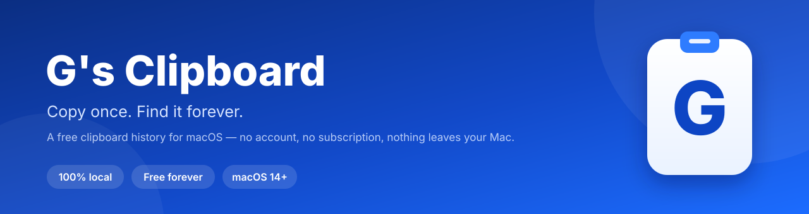
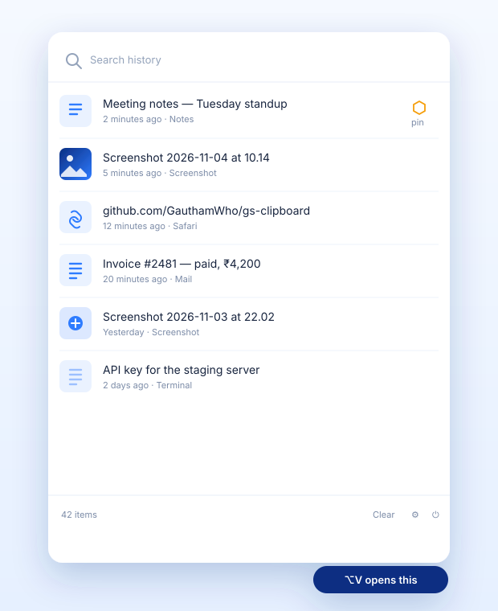
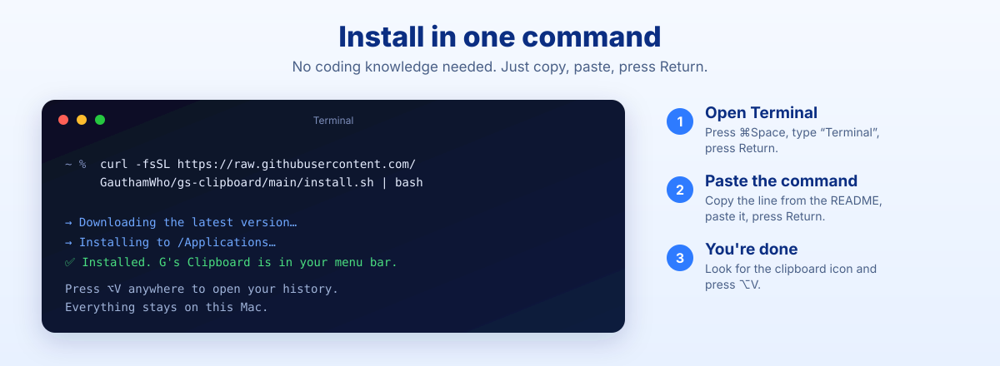
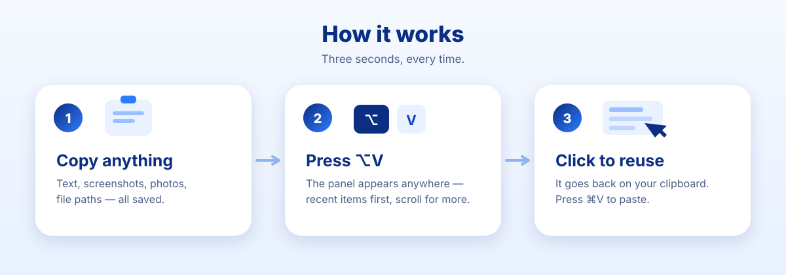

<p align="center">
  
</p>

<p align="center">
  
  
  
  
</p>

**G's Clipboard** remembers everything you copy — text, screenshots, photos, and
file paths — so you never lose something you copied five minutes ago.

Press **⌥V** anywhere on your Mac and your history appears, newest first. Click
an item to put it back on your clipboard. Press **⌘V** to paste.

No subscription. No account. No ads. Nothing leaves your Mac.

---

## Why this exists

Clipboard apps usually charge a monthly fee for something simple: remembering
what you copied.

G's Clipboard does it for free, forever. It is built and maintained by
**[Gautam Who](https://instagram.com/gautamwho)** and given to everyone who
needs it.

---

## What it does

| | |
|---|---|
| 📋 **Unlimited history** | Every text you copy is saved. |
| 🖼️ **Images too** | Screenshots and copied photos are saved as pictures. |
| 📁 **File paths** | Copying files keeps a reusable list of their paths. |
| 🔎 **Search** | Type a word to find something you copied weeks ago. |
| 📌 **Pin** | Keep important items forever — they are never cleared. |
| ⌨️ **⌥V anywhere** | One shortcut opens the panel in any app. |
| 🚀 **Starts with your Mac** | It is already running when you log in. |
| 🔒 **100% local** | Your clipboard never goes to a server. |
| 🔄 **Easy updates** | It checks once a day and installs new versions in one click. |

<p align="center">
  
</p>

---

## Install in one command

### 1. Open Terminal

Press **⌘Space**, type **Terminal**, and press **Return**.

### 2. Copy this line

```bash
curl -fsSL https://raw.githubusercontent.com/GauthamWho/gs-clipboard/main/install.sh | bash
```

### 3. Paste it into Terminal and press **Return**

Paste with **⌘V**, then press **Return**. Wait about ten seconds.

That's it. A clipboard icon appears in your menu bar, and the app starts
automatically from now on.

<p align="center">
  
</p>

> **Prefer not to use Terminal?**
> Go to [Releases](https://github.com/GauthamWho/gs-clipboard/releases), download
> `GsClipboard.app.zip`, unzip it, and drag **G's Clipboard** into your
> Applications folder. On the first launch, **right-click the app → Open**
> (macOS asks this once for free apps that are not sold through the App Store).

---

## How it works

<p align="center">
  
</p>

1. **Copy** text, a screenshot, or a file like you always do.
2. **Press ⌥V** (Option + V). The panel opens with your newest items on top.
3. **Scroll** down to go further back in time.
4. **Click** an item to copy it again.
5. **Press ⌘V** in the app where you want it.

### Keyboard and mouse

| Action | What it does |
|---|---|
| **⌥V** | Open or close the panel from anywhere |
| **Esc** | Close the panel |
| **Click an item** | Put it back on the clipboard |
| **📌 pin** | Keep an item forever |
| **🗑 trash** | Delete one item |
| **Clear** | Delete everything that is not pinned |
| **Right-click the menu-bar icon** | About, updates, settings, quit |
| **Gear icon** | Settings and updates |

---

## Updates

G's Clipboard checks GitHub **once a day** for a new version.

- If there is an update, you will see **“Update 1.0.1”** in the panel and in the
  right-click menu.
- Click it. The app closes, installs the new version, and opens again. Your
  history is not touched.
- You can also check by hand in **Settings → Updates**.

The check sends only a request for the latest version number. It does not send
your clipboard, your name, or anything about you. You can turn it off in
**Settings → General**.

**Want a new feature?**
Message [@gautamwho on Instagram](https://instagram.com/gautamwho) or open an
[Issue](https://github.com/GauthamWho/gs-clipboard/issues). If it helps
everyone, it ships in the next update.

---

## Privacy

**Your clipboard is yours.** The app stores history only in this folder on your
Mac:

```
~/Library/Application Support/G's Clipboard/
```

- No account, no cloud, no ads, no analytics, no telemetry.
- The developer cannot see what you copy.
- No Accessibility permission, no Screen Recording permission, no Full Disk
  Access.
- The only network request is the daily version check to GitHub.

Read the full details in [PRIVACY.md](PRIVACY.md).

---

## Questions

<details>
<summary><b>Does it work on my Mac?</b></summary>

Yes if you have **macOS 14 Sonoma or newer**. It runs natively on both Apple
Silicon (M1, M2, M3, M4…) and Intel Macs.
</details>

<details>
<summary><b>Is it really free?</b></summary>

Yes. No subscription, no trial, no “pro” version. The
[license](LICENSE) allows free personal use forever. You may not sell it or
rebrand it.
</details>

<details>
<summary><b>Where is my history saved? Can I back it up?</b></summary>

In `~/Library/Application Support/G's Clipboard/`. Copy that folder to back it
up or to move it to another Mac.
</details>

<details>
<summary><b>Does it sync between Macs?</b></summary>

No. Everything stays on the Mac where you copied it. That is intentional: no
server means nobody can read your clipboard.

</details>

<details>
<summary><b>Why ⌥V and not Fn+V or Windows+V?</b></summary>

macOS does not let normal apps capture the **Fn** key without special
permissions, and **⌘V** is already the system paste shortcut. **⌥V** works
everywhere, needs no permissions, and is one of the bottom-left keys — the same
muscle memory as Windows+V.
</details>

<details>
<summary><b>Does it save passwords I copy?</b></summary>

Yes, like every clipboard manager. If you copy a password from a password
manager, it can appear in your history. Delete it with the trash icon, or press
**Clear** after using it. An app-exclusion feature is planned.
</details>

<details>
<summary><b>The app does not open / macOS says it is damaged.</b></summary>

This is macOS protecting you from apps it does not recognise. The one-line
installer removes that flag automatically. If you downloaded the ZIP with a
browser, run this once in Terminal:

```bash
xattr -dr com.apple.quarantine "/Applications/G's Clipboard.app"
open "/Applications/G's Clipboard.app"
```

Or open **System Settings → Privacy & Security** and click **Open Anyway**.
</details>

<details>
<summary><b>I copied something but the panel did not show it.</b></summary>

Make sure you are looking at **G's Clipboard** (the clipboard icon with the blue
**G**), not another clipboard app. If you still have an old clipboard manager
installed, two panels can fight over the same shortcut.

If the app is up to date (1.0.1 or newer) the list updates instantly. If you are
on 1.0.0, quit the app from the menu-bar icon and open it again — or update from
**Settings → Updates**.

Still stuck? Send the log file, which stays on your Mac:

```bash
open "$HOME/Library/Logs/G's Clipboard.log"
```
</details>

<details>
<summary><b>⌥V does nothing.</b></summary>

Another app may already use that shortcut. Quit that app, or tell us which one
and we will add a configurable shortcut in a future version. Also make sure
G's Clipboard is running (clipboard icon in the menu bar).

</details>

<details>
<summary><b>How do I uninstall it?</b></summary>

1. Right-click the menu-bar icon → **Quit**.
2. Drag **G's Clipboard** from Applications to the Trash.
3. Optionally delete your history:
   `rm -rf "$HOME/Library/Application Support/G's Clipboard"`
4. Remove it from **System Settings → General → Login Items** if it is still
   listed.
</details>

---

## Built with

- **Swift** and **SwiftUI**, no third-party dependencies.
- The system-wide shortcut uses Apple's Carbon hot-key API, so it needs **no
  permissions**.
- The app is small (under 2 MB) and starts instantly.

## For developers

```bash
git clone https://github.com/GauthamWho/gs-clipboard.git
cd gs-clipboard
./build.sh
open "build/G's Clipboard.app"
```

Project layout:

| File | Purpose |
|---|---|
| `Sources/GsClipboard/AppDelegate.swift` | Menu-bar item, popover, hotkey, windows |
| `HotKeyManager.swift` | Global ⌥V shortcut |
| `ClipStore.swift` | History, dedupe, pasteboard writing |
| `ClipboardMonitor.swift` | Watches the pasteboard |
| `ContentView.swift` | The history panel |
| `Thumbnails.swift` | Image thumbnail cache |
| `UpdateChecker.swift` | GitHub release check + in-place update |
| `SettingsView.swift` / `AboutView.swift` | Settings and About windows |
| `tools/make-icon.swift` | Generates the app icon |
| `install.sh` | The one-line installer |
| `release.sh` | Publishes a new version |

Releases are built for both Apple Silicon and Intel, and published with
[`release.sh`](release.sh).

---

## License

**© 2026 Gautam Who. All rights reserved.**

Free to use and share for personal use. You may not sell it, put it behind a
paywall, or rebrand it. See [LICENSE](LICENSE).

If you want to use it commercially, message
[@gautamwho](https://instagram.com/gautamwho).

<p align="center">
  <sub>Made with care by <a href="https://instagram.com/gautamwho">Gautam Who</a> · If this saved you a subscription, tell a friend.</sub>
</p>
